# Отчёт: Docker Compose проект с WordPress

Дата проверки: 20.11.2026, 12:52:52 (Москва).

Проект: `DockerCompose/wordpress`. Инструкция: [WordPress.md](https://github.com/rurewa/imfua/blob/main/content/Docker/DockerCompose/WordPress.md).

WordPress установлен на русском языке, выполнен вход администратора `user`. Сайт: <http://localhost:8081>, панель: <http://localhost:8081/wp-admin/>. Пароль находится в локальном `.env`, ключ `WORDPRESS_ADMIN_PASSWORD`; файл исключён из Git. Учебный email: `student@example.test`.

## Скриншоты браузера

Снимки содержимого настоящих страниц Chrome. Пароль на форме установки закрыт маской.

### Выбор русского языка

Адрес: http://localhost:8081/wp-admin/install.php

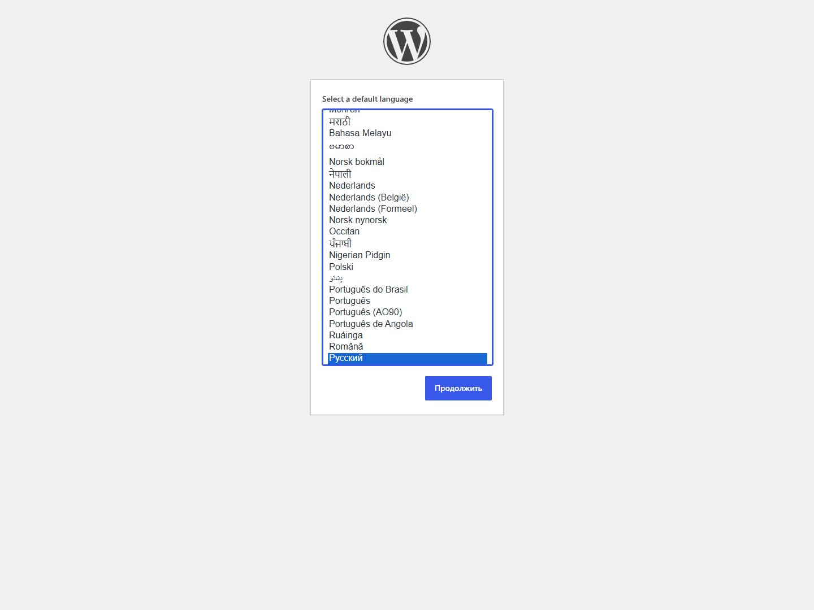

### Заполнение мастера установки

Адрес: http://localhost:8081/wp-admin/install.php?step=1

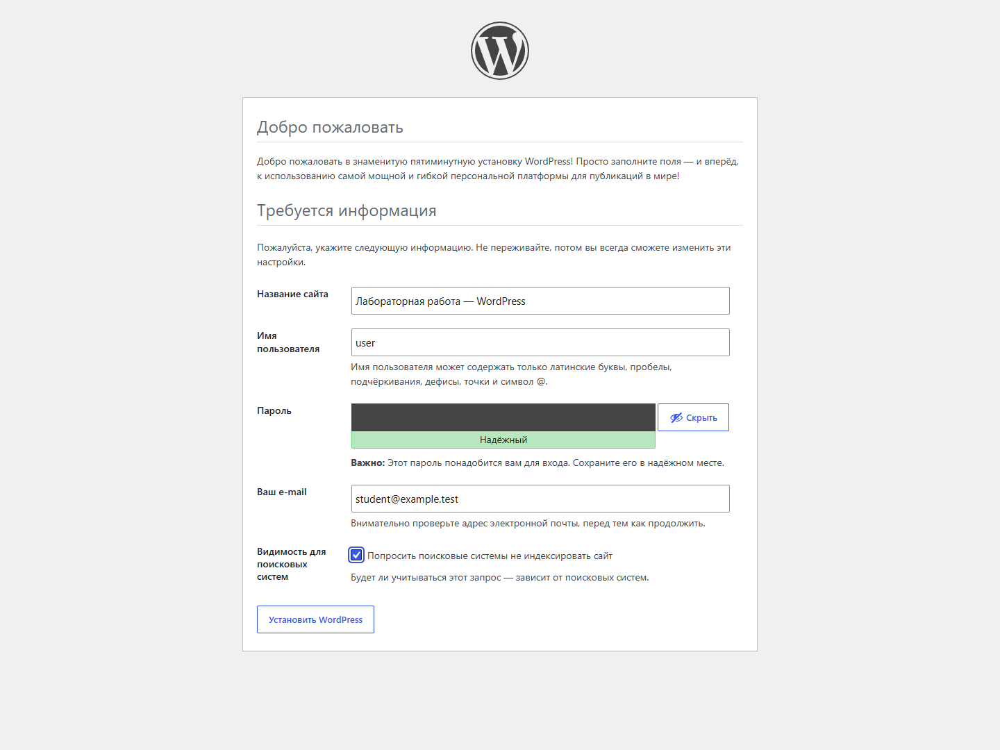

### Установка завершена

Адрес: http://localhost:8081/wp-admin/install.php?step=2

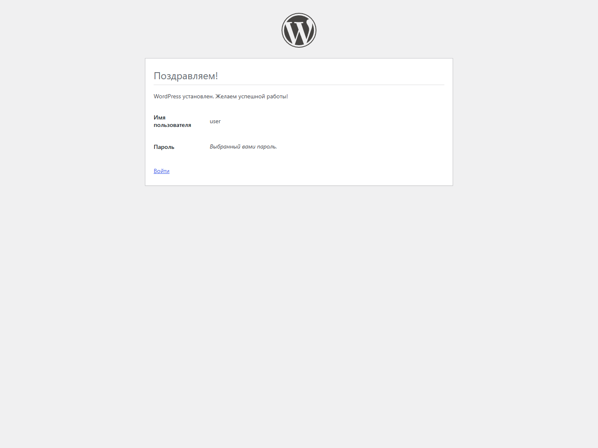

### Форма входа

Адрес: http://localhost:8081/wp-login.php

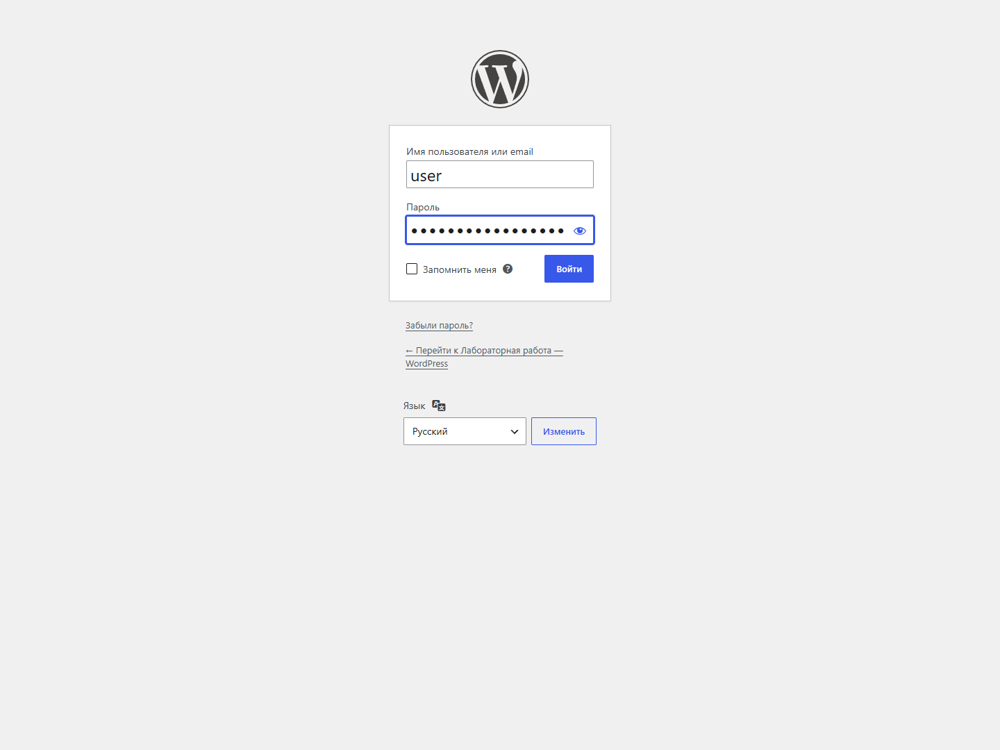

### Панель управления после входа

Адрес: http://localhost:8081/wp-admin/

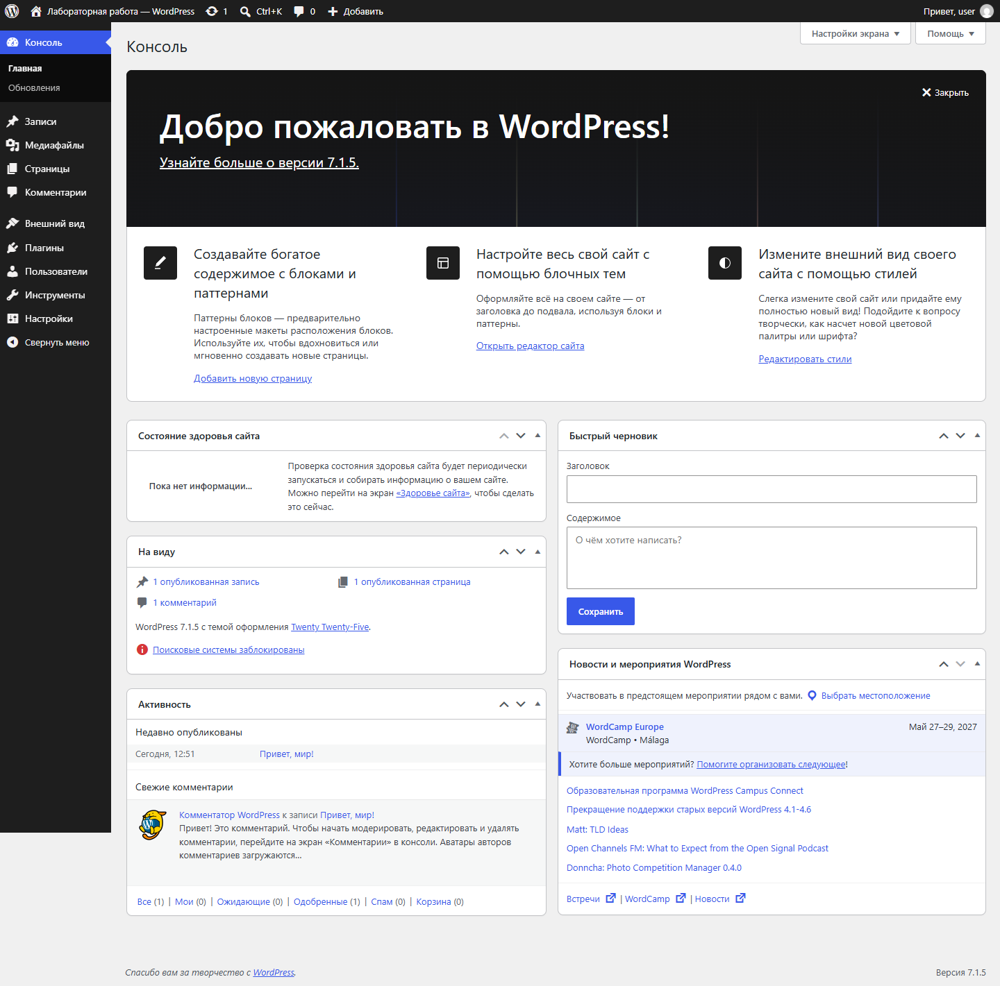

### Сайт, открытый администратором

Адрес: http://localhost:8081/

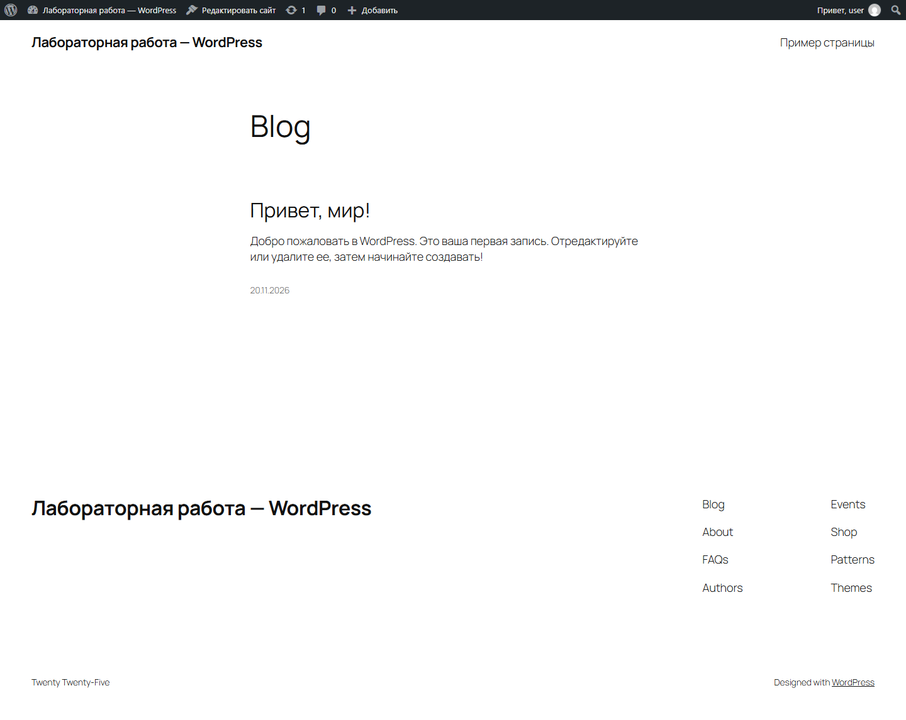

### Главная страница для посетителя

Адрес: http://localhost:8081/

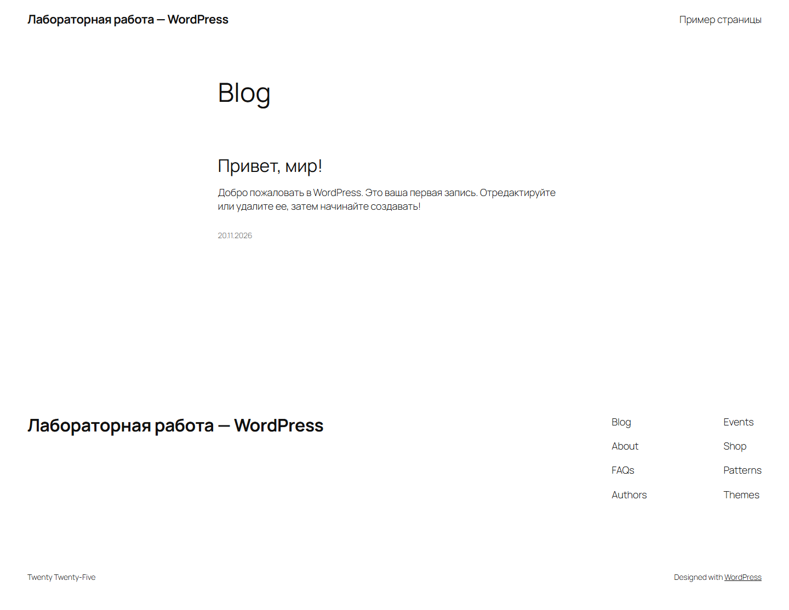

## Фактические результаты команд

Ниже сохранён настоящий вывод Docker CLI и HTTP-проверки. Дополнительные изображения — снимки этого вывода, отображённого в браузере для удобства сдачи; это не снимки окна терминала. Пароли в отчёт не включены.

### Проверка окружения и проектов

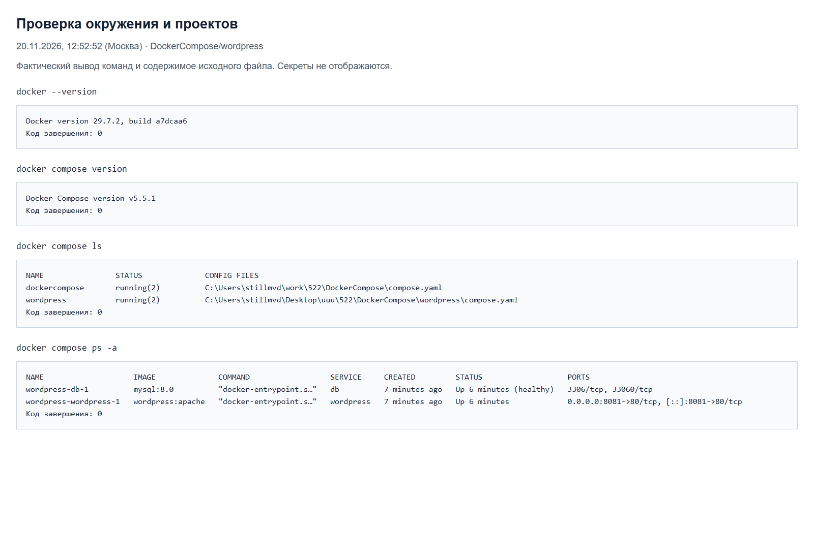

```text
> docker --version
Docker version 29.7.2, build a7dcaa6
Код завершения: 0
```

```text
> docker compose version
Docker Compose version v5.5.1
Код завершения: 0
```

```text
> docker compose ls
NAME                STATUS              CONFIG FILES
dockercompose       running(2)          C:\Users\stillmvd\work\522\DockerCompose\compose.yaml
wordpress           running(2)          C:\Users\stillmvd\Desktop\uuu\522\DockerCompose\wordpress\compose.yaml
Код завершения: 0
```

```text
> docker compose ps -a
NAME                    IMAGE              COMMAND                  SERVICE     CREATED         STATUS                   PORTS
wordpress-db-1          mysql:8.0          "docker-entrypoint.s…"   db          7 minutes ago   Up 6 minutes (healthy)   3306/tcp, 33060/tcp
wordpress-wordpress-1   wordpress:apache   "docker-entrypoint.s…"   wordpress   7 minutes ago   Up 6 minutes             0.0.0.0:8081->80/tcp, [::]:8081->80/tcp
Код завершения: 0
```

### Проверка stop, start, restart и сохранности WordPress

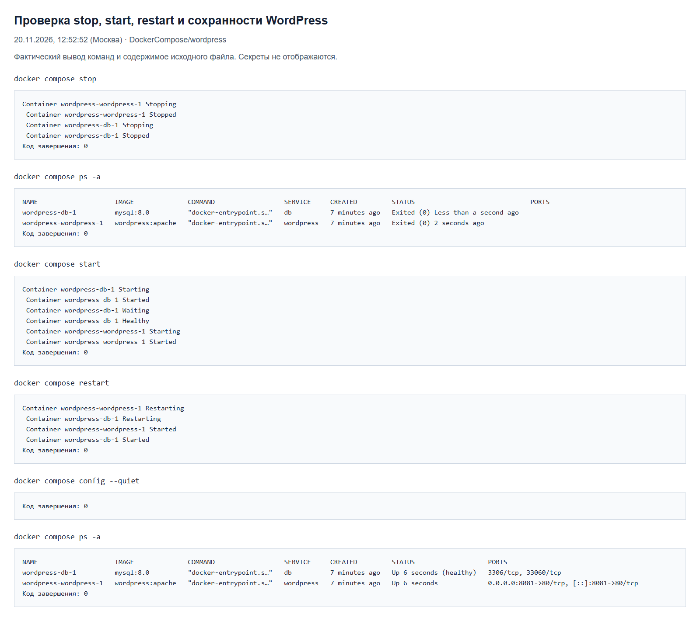

```text
> docker compose stop
Container wordpress-wordpress-1 Stopping
 Container wordpress-wordpress-1 Stopped
 Container wordpress-db-1 Stopping
 Container wordpress-db-1 Stopped
Код завершения: 0
```

```text
> docker compose ps -a
NAME                    IMAGE              COMMAND                  SERVICE     CREATED         STATUS                              PORTS
wordpress-db-1          mysql:8.0          "docker-entrypoint.s…"   db          7 minutes ago   Exited (0) Less than a second ago
wordpress-wordpress-1   wordpress:apache   "docker-entrypoint.s…"   wordpress   7 minutes ago   Exited (0) 2 seconds ago
Код завершения: 0
```

```text
> docker compose start
Container wordpress-db-1 Starting
 Container wordpress-db-1 Started
 Container wordpress-db-1 Waiting
 Container wordpress-db-1 Healthy
 Container wordpress-wordpress-1 Starting
 Container wordpress-wordpress-1 Started
Код завершения: 0
```

```text
> docker compose restart
Container wordpress-wordpress-1 Restarting
 Container wordpress-db-1 Restarting
 Container wordpress-wordpress-1 Started
 Container wordpress-db-1 Started
Код завершения: 0
```

```text
> docker compose config --quiet

Код завершения: 0
```

```text
> docker compose ps -a
NAME                    IMAGE              COMMAND                  SERVICE     CREATED         STATUS                   PORTS
wordpress-db-1          mysql:8.0          "docker-entrypoint.s…"   db          7 minutes ago   Up 6 seconds (healthy)   3306/tcp, 33060/tcp
wordpress-wordpress-1   wordpress:apache   "docker-entrypoint.s…"   wordpress   7 minutes ago   Up 6 seconds             0.0.0.0:8081->80/tcp, [::]:8081->80/tcp
Код завершения: 0
```

### Логи MySQL и Apache после перезапуска

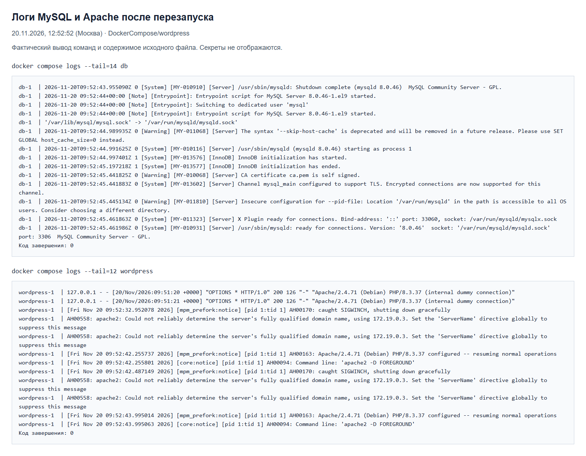

```text
> docker compose logs --tail=14 db
db-1  | 2026-11-20T09:52:43.955090Z 0 [System] [MY-010910] [Server] /usr/sbin/mysqld: Shutdown complete (mysqld 8.0.46)  MySQL Community Server - GPL.
db-1  | 2026-11-20 09:52:44+00:00 [Note] [Entrypoint]: Entrypoint script for MySQL Server 8.0.46-1.el9 started.
db-1  | 2026-11-20 09:52:44+00:00 [Note] [Entrypoint]: Switching to dedicated user 'mysql'
db-1  | 2026-11-20 09:52:44+00:00 [Note] [Entrypoint]: Entrypoint script for MySQL Server 8.0.46-1.el9 started.
db-1  | '/var/lib/mysql/mysql.sock' -> '/var/run/mysqld/mysqld.sock'
db-1  | 2026-11-20T09:52:44.989935Z 0 [Warning] [MY-011068] [Server] The syntax '--skip-host-cache' is deprecated and will be removed in a future release. Please use SET GLOBAL host_cache_size=0 instead.
db-1  | 2026-11-20T09:52:44.991625Z 0 [System] [MY-010116] [Server] /usr/sbin/mysqld (mysqld 8.0.46) starting as process 1
db-1  | 2026-11-20T09:52:44.997401Z 1 [System] [MY-013576] [InnoDB] InnoDB initialization has started.
db-1  | 2026-11-20T09:52:45.197218Z 1 [System] [MY-013577] [InnoDB] InnoDB initialization has ended.
db-1  | 2026-11-20T09:52:45.441825Z 0 [Warning] [MY-010068] [Server] CA certificate ca.pem is self signed.
db-1  | 2026-11-20T09:52:45.441883Z 0 [System] [MY-013602] [Server] Channel mysql_main configured to support TLS. Encrypted connections are now supported for this channel.
db-1  | 2026-11-20T09:52:45.445134Z 0 [Warning] [MY-011810] [Server] Insecure configuration for --pid-file: Location '/var/run/mysqld' in the path is accessible to all OS users. Consider choosing a different directory.
db-1  | 2026-11-20T09:52:45.461863Z 0 [System] [MY-011323] [Server] X Plugin ready for connections. Bind-address: '::' port: 33060, socket: /var/run/mysqld/mysqlx.sock
db-1  | 2026-11-20T09:52:45.461986Z 0 [System] [MY-010931] [Server] /usr/sbin/mysqld: ready for connections. Version: '8.0.46'  socket: '/var/run/mysqld/mysqld.sock'  port: 3306  MySQL Community Server - GPL.
Код завершения: 0
```

```text
> docker compose logs --tail=12 wordpress
wordpress-1  | 127.0.0.1 - - [20/Nov/2026:09:51:20 +0000] "OPTIONS * HTTP/1.0" 200 126 "-" "Apache/2.4.71 (Debian) PHP/8.3.37 (internal dummy connection)"
wordpress-1  | 127.0.0.1 - - [20/Nov/2026:09:51:21 +0000] "OPTIONS * HTTP/1.0" 200 126 "-" "Apache/2.4.71 (Debian) PHP/8.3.37 (internal dummy connection)"
wordpress-1  | [Fri Nov 20 09:52:32.952078 2026] [mpm_prefork:notice] [pid 1:tid 1] AH00170: caught SIGWINCH, shutting down gracefully
wordpress-1  | AH00558: apache2: Could not reliably determine the server's fully qualified domain name, using 172.19.0.3. Set the 'ServerName' directive globally to suppress this message
wordpress-1  | AH00558: apache2: Could not reliably determine the server's fully qualified domain name, using 172.19.0.3. Set the 'ServerName' directive globally to suppress this message
wordpress-1  | [Fri Nov 20 09:52:42.255737 2026] [mpm_prefork:notice] [pid 1:tid 1] AH00163: Apache/2.4.71 (Debian) PHP/8.3.37 configured -- resuming normal operations
wordpress-1  | [Fri Nov 20 09:52:42.255801 2026] [core:notice] [pid 1:tid 1] AH00094: Command line: 'apache2 -D FOREGROUND'
wordpress-1  | [Fri Nov 20 09:52:42.487149 2026] [mpm_prefork:notice] [pid 1:tid 1] AH00170: caught SIGWINCH, shutting down gracefully
wordpress-1  | AH00558: apache2: Could not reliably determine the server's fully qualified domain name, using 172.19.0.3. Set the 'ServerName' directive globally to suppress this message
wordpress-1  | AH00558: apache2: Could not reliably determine the server's fully qualified domain name, using 172.19.0.3. Set the 'ServerName' directive globally to suppress this message
wordpress-1  | [Fri Nov 20 09:52:43.995014 2026] [mpm_prefork:notice] [pid 1:tid 1] AH00163: Apache/2.4.71 (Debian) PHP/8.3.37 configured -- resuming normal operations
wordpress-1  | [Fri Nov 20 09:52:43.995063 2026] [core:notice] [pid 1:tid 1] AH00094: Command line: 'apache2 -D FOREGROUND'
Код завершения: 0
```

### Конфигурация и проверка установленного WordPress

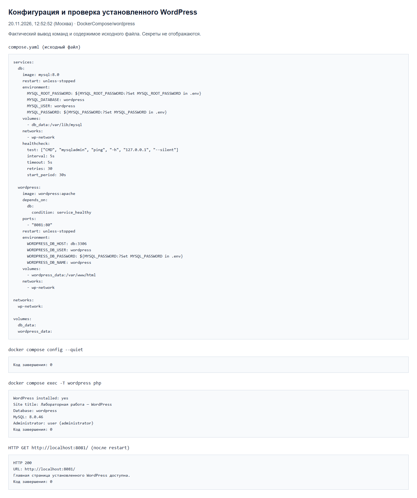

```text
> compose.yaml (исходный файл)
services:
  db:
    image: mysql:8.0
    restart: unless-stopped
    environment:
      MYSQL_ROOT_PASSWORD: ${MYSQL_ROOT_PASSWORD:?Set MYSQL_ROOT_PASSWORD in .env}
      MYSQL_DATABASE: wordpress
      MYSQL_USER: wordpress
      MYSQL_PASSWORD: ${MYSQL_PASSWORD:?Set MYSQL_PASSWORD in .env}
    volumes:
      - db_data:/var/lib/mysql
    networks:
      - wp-network
    healthcheck:
      test: ["CMD", "mysqladmin", "ping", "-h", "127.0.0.1", "--silent"]
      interval: 5s
      timeout: 5s
      retries: 30
      start_period: 30s

  wordpress:
    image: wordpress:apache
    depends_on:
      db:
        condition: service_healthy
    ports:
      - "8081:80"
    restart: unless-stopped
    environment:
      WORDPRESS_DB_HOST: db:3306
      WORDPRESS_DB_USER: wordpress
      WORDPRESS_DB_PASSWORD: ${MYSQL_PASSWORD:?Set MYSQL_PASSWORD in .env}
      WORDPRESS_DB_NAME: wordpress
    volumes:
      - wordpress_data:/var/www/html
    networks:
      - wp-network

networks:
  wp-network:

volumes:
  db_data:
  wordpress_data:
```

```text
> docker compose config --quiet

Код завершения: 0
```

```text
> docker compose exec -T wordpress php
WordPress installed: yes
Site title: Лабораторная работа — WordPress
Database: wordpress
MySQL: 8.0.46
Administrator: user (administrator)
Код завершения: 0
```

```text
> HTTP GET http://localhost:8081/ (после restart)
HTTP 200
URL: http://localhost:8081/
Главная страница установленного WordPress доступна.
Код завершения: 0
```

## Итог

Оба контейнера запущены, MySQL healthy; после stop/start/restart данные установки сохранены. Главная страница возвращает HTTP 200. Существующие проекты не останавливались, тома не удалялись. Дополнительных действий в мастере установки не требуется.
